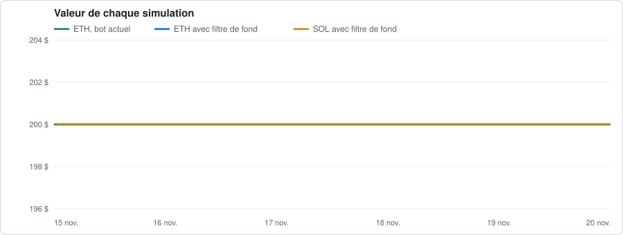

# Simulations du bot (argent fictif)

Mis à jour le **18 nov. 2026 à 19 h 14** (heure de Montréal). Les bots se réveillent environ toutes les 30 minutes ; GitHub a souvent du retard.

| Simulation | Statut | Valeur | Si tu avais acheté et gardé | Transactions |
|---|---|---|---|---|
| [**ETH, bot actuel**](eth/README.md) | ⚪ Hors position | **200,00 $** (+0,0 %) | 195,66 $ (−2,2 %) | 0 |
| [**ETH avec filtre de fond**](eth-filtre/README.md) | ⚪ Hors position | **200,00 $** (+0,0 %) | 194,59 $ (−2,7 %) | 0 |
| [**SOL avec filtre de fond**](sol-filtre/README.md) | ⚪ Hors position | **200,00 $** (+0,0 %) | 204,95 $ (+2,5 %) | 0 |

Clique sur le nom d'une simulation pour voir son tableau de bord complet : prochain signal, graphiques et transactions.

- **ETH, bot actuel** : La stratégie de départ : croisement des moyennes 10 et 30 jours.
- **ETH avec filtre de fond** : Même stratégie, mais le bot n'achète que si le prix est aussi au-dessus de sa moyenne 100 jours.
- **SOL avec filtre de fond** : Solana, avec le filtre de fond 100 jours.

## Valeur de chaque simulation

## Les analyses

- [Comparaison de la stratégie sur ETH, BTC, SOL et XRP](COMPARAISON.md)
- [Test des améliorations : pourquoi le filtre de fond a été retenu](AMELIORATIONS.md)
- [Instructions](LISEZ-MOI.md)

---
Chaque simulation démarre avec 200 $ fictifs. Ce n'est pas un conseil financier.
