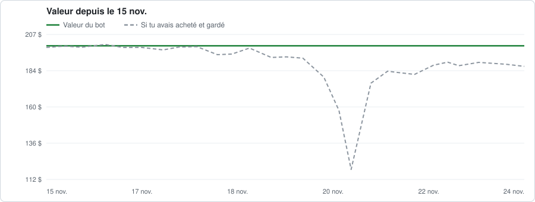

# ETH avec filtre de fond : simulation (argent fictif)

Même stratégie, mais le bot n'achète que si le prix est aussi au-dessus de sa moyenne 100 jours.

Mis à jour le **21 nov. 2026 à 19 h 15** (heure de Montréal). Le bot se réveille environ toutes les 30 minutes ; GitHub a souvent du retard.

| | |
|---|---|
| Statut | ⚪ **Hors position** (en attente d'un signal d'achat) |
| Valeur du bot | **200,00 $** (+0,0 % depuis le départ) |
| Si tu avais acheté et gardé | 182,43 $ (−8,8 %) |
| Prix ETH/CAD | 2 379,05 $ |
| Transactions | 0 · frais payés : 0,00 $ |

## Prochain signal

- Moyenne 10 jours : **2 514 $** · Moyenne 30 jours : **2 951 $** (la moyenne courte est 14,8 % en dessous de la longue)
- Filtre de fond : le prix doit aussi être au-dessus de sa moyenne 100 jours (**3 317 $**). En ce moment, il est **en dessous**.
- Un signal d'achat dès ce soir est **impossible** : il faudra plusieurs jours de hausse pour que la moyenne 10 jours remonte au-dessus de la moyenne 30 jours et que le prix repasse au-dessus de sa moyenne 100 jours.

Les moyennes ne changent qu'une fois par jour, à la clôture de la bougie quotidienne. Entre-temps, seul le prix bouge.

## Prix et moyennes

## Valeur du bot

## Transactions

Aucune transaction pour l'instant.

## Derniers réveils

| Heure | Prix | Position | Valeur |
|---|---|---|---|
| 21 nov. 19 h 15 | 2 379,05 $ | Hors position | 200,00 $ |
| 21 nov. 14 h 43 | 2 390,77 $ | Hors position | 200,00 $ |
| 21 nov. 7 h 28 | 2 287,91 $ | Hors position | 200,00 $ |
| 20 nov. 22 h 54 | 1 547,83 $ | Hors position | 200,00 $ |
| 20 nov. 17 h 37 | 2 053,67 $ | Hors position | 200,00 $ |
| 20 nov. 11 h 02 | 2 340,42 $ | Hors position | 200,00 $ |
| 20 nov. 1 h 59 | 2 502,22 $ | Hors position | 200,00 $ |
| 19 nov. 18 h 45 | 2 513,51 $ | Hors position | 200,00 $ |

---
Simulation avec 200 $ fictifs, frais de 0,26 % par transaction inclus. Ce n'est pas un conseil financier. Instructions : [LISEZ-MOI.md](../LISEZ-MOI.md) · [Retour au résumé](../README.md)
