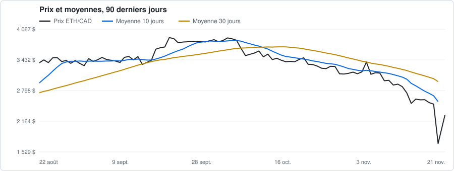
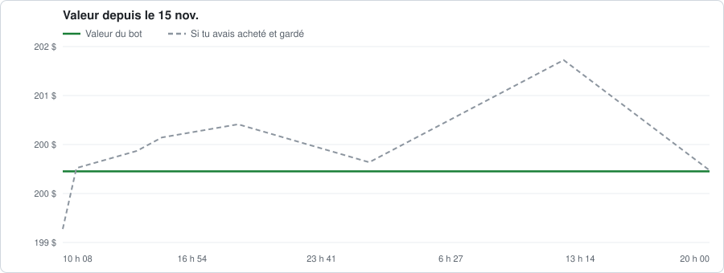

# ETH, bot actuel : simulation (argent fictif)

La stratégie de départ : croisement des moyennes 10 et 30 jours.

Mis à jour le **27 nov. 2026 à 23 h 55** (heure de Montréal). Le bot se réveille environ toutes les 30 minutes ; GitHub a souvent du retard.

| | |
|---|---|
| Statut | ⚪ **Hors position** (en attente d'un signal d'achat) |
| Valeur du bot | **200,00 $** (+0,0 % depuis le départ) |
| Si tu avais acheté et gardé | 183,31 $ (−8,3 %) |
| Prix ETH/CAD | 2 377,42 $ |
| Transactions | 0 · frais payés : 0,00 $ |

## Prochain signal

- Moyenne 10 jours : **2 362 $** · Moyenne 30 jours : **2 775 $** (la moyenne courte est 14,9 % en dessous de la longue)
- Un signal d'achat dès ce soir est **impossible** : il faudra plusieurs jours de hausse pour que la moyenne 10 jours remonte au-dessus de la moyenne 30 jours.

Les moyennes ne changent qu'une fois par jour, à la clôture de la bougie quotidienne. Entre-temps, seul le prix bouge.

## Prix et moyennes

## Valeur du bot

## Transactions

Aucune transaction pour l'instant.

## Derniers réveils

| Heure | Prix | Position | Valeur |
|---|---|---|---|
| 27 nov. 23 h 55 | 2 377,42 $ | Hors position | 200,00 $ |
| 27 nov. 18 h 22 | 2 361,79 $ | Hors position | 200,00 $ |
| 27 nov. 9 h 54 | 2 360,65 $ | Hors position | 200,00 $ |
| 26 nov. 23 h 55 | 2 467,19 $ | Hors position | 200,00 $ |
| 26 nov. 17 h 55 | 2 419,31 $ | Hors position | 200,00 $ |
| 26 nov. 8 h 48 | 2 423,30 $ | Hors position | 200,00 $ |
| 25 nov. 23 h 05 | 2 415,79 $ | Hors position | 200,00 $ |
| 25 nov. 16 h 57 | 2 400,50 $ | Hors position | 200,00 $ |

---
Simulation avec 200 $ fictifs, frais de 0,26 % par transaction inclus. Ce n'est pas un conseil financier. Instructions : [LISEZ-MOI.md](../LISEZ-MOI.md) · [Retour au résumé](../README.md)
