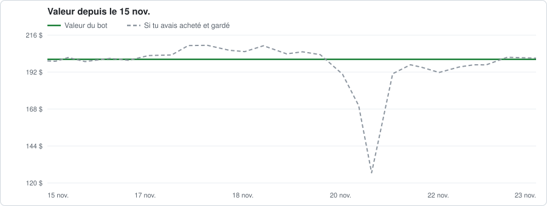

# SOL avec filtre de fond : simulation (argent fictif)

Solana, avec le filtre de fond 100 jours.

Mis à jour le **19 nov. 2026 à 2 h 51** (heure de Montréal). Le bot se réveille environ toutes les 30 minutes ; GitHub a souvent du retard.

| | |
|---|---|
| Statut | ⚪ **Hors position** (en attente d'un signal d'achat) |
| Valeur du bot | **200,00 $** (+0,0 % depuis le départ) |
| Si tu avais acheté et gardé | 208,75 $ (+4,4 %) |
| Prix SOL/CAD | 107,02 $ |
| Transactions | 0 · frais payés : 0,00 $ |

## Prochain signal

- Moyenne 10 jours : **111 $** · Moyenne 30 jours : **128 $** (la moyenne courte est 13,4 % en dessous de la longue)
- Filtre de fond : le prix doit aussi être au-dessus de sa moyenne 100 jours (**140 $**). En ce moment, il est **en dessous**.
- Un signal d'achat dès ce soir est **impossible** : il faudra plusieurs jours de hausse pour que la moyenne 10 jours remonte au-dessus de la moyenne 30 jours et que le prix repasse au-dessus de sa moyenne 100 jours.

Les moyennes ne changent qu'une fois par jour, à la clôture de la bougie quotidienne. Entre-temps, seul le prix bouge.

## Prix et moyennes

## Valeur du bot

## Transactions

Aucune transaction pour l'instant.

## Derniers réveils

| Heure | Prix | Position | Valeur |
|---|---|---|---|
| 19 nov. 2 h 51 | 107,02 $ | Hors position | 200,00 $ |
| 18 nov. 19 h 14 | 105,07 $ | Hors position | 200,00 $ |
| 18 nov. 12 h 57 | 105,52 $ | Hors position | 200,00 $ |
| 18 nov. 4 h 02 | 107,15 $ | Hors position | 200,00 $ |
| 17 nov. 20 h 14 | 107,07 $ | Hors position | 200,00 $ |
| 17 nov. 13 h 28 | 103,98 $ | Hors position | 200,00 $ |
| 17 nov. 4 h 02 | 103,77 $ | Hors position | 200,00 $ |
| 16 nov. 20 h 00 | 102,20 $ | Hors position | 200,00 $ |

---
Simulation avec 200 $ fictifs, frais de 0,26 % par transaction inclus. Ce n'est pas un conseil financier. Instructions : [LISEZ-MOI.md](../LISEZ-MOI.md) · [Retour au résumé](../README.md)
