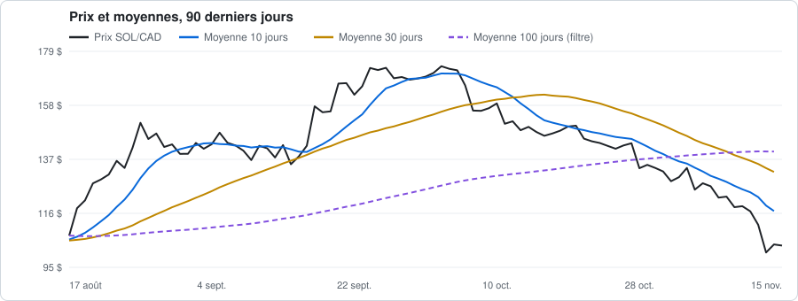

# SOL avec filtre de fond : simulation (argent fictif)

Solana, avec le filtre de fond 100 jours.

Mis à jour le **27 nov. 2026 à 18 h 23** (heure de Montréal). Le bot se réveille environ toutes les 30 minutes ; GitHub a souvent du retard.

| | |
|---|---|
| Statut | ⚪ **Hors position** (en attente d'un signal d'achat) |
| Valeur du bot | **200,00 $** (+0,0 % depuis le départ) |
| Si tu avais acheté et gardé | 198,01 $ (−1,0 %) |
| Prix SOL/CAD | 101,51 $ |
| Transactions | 0 · frais payés : 0,00 $ |

## Prochain signal

- Moyenne 10 jours : **99 $** · Moyenne 30 jours : **115 $** (la moyenne courte est 13,7 % en dessous de la longue)
- Filtre de fond : le prix doit aussi être au-dessus de sa moyenne 100 jours (**139 $**). En ce moment, il est **en dessous**.
- Un signal d'achat dès ce soir est **impossible** : il faudra plusieurs jours de hausse pour que la moyenne 10 jours remonte au-dessus de la moyenne 30 jours et que le prix repasse au-dessus de sa moyenne 100 jours.

Les moyennes ne changent qu'une fois par jour, à la clôture de la bougie quotidienne. Entre-temps, seul le prix bouge.

## Prix et moyennes

## Valeur du bot

## Transactions

Aucune transaction pour l'instant.

## Derniers réveils

| Heure | Prix | Position | Valeur |
|---|---|---|---|
| 27 nov. 18 h 23 | 101,51 $ | Hors position | 200,00 $ |
| 27 nov. 9 h 55 | 101,11 $ | Hors position | 200,00 $ |
| 26 nov. 23 h 55 | 103,46 $ | Hors position | 200,00 $ |
| 26 nov. 17 h 55 | 101,51 $ | Hors position | 200,00 $ |
| 26 nov. 8 h 48 | 101,00 $ | Hors position | 200,00 $ |
| 25 nov. 23 h 05 | 101,08 $ | Hors position | 200,00 $ |
| 25 nov. 16 h 58 | 100,49 $ | Hors position | 200,00 $ |
| 25 nov. 7 h 36 | 96,61 $ | Hors position | 200,00 $ |

---
Simulation avec 200 $ fictifs, frais de 0,26 % par transaction inclus. Ce n'est pas un conseil financier. Instructions : [LISEZ-MOI.md](../LISEZ-MOI.md) · [Retour au résumé](../README.md)
